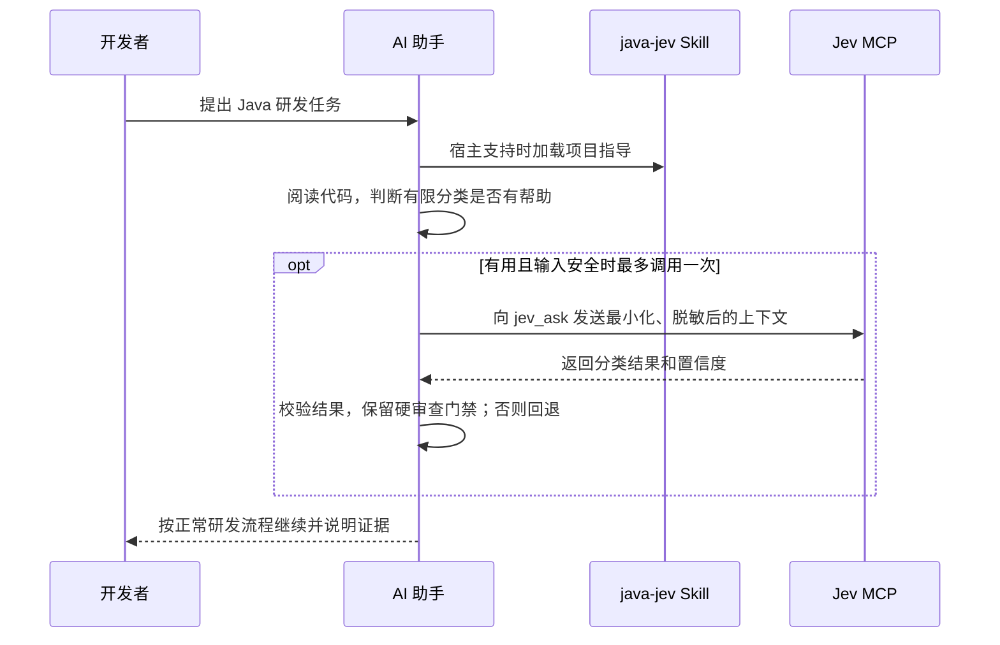

# Java Jev Kit

[English](../../README.md) | 简体中文

面向 Java 后端开发的可选、有限范围决策辅助工具。Jev 负责分类少量工程问题；代码阅读、方案决定、变更审查和最终交付仍由你的 AI 助手负责。

## 安装

在 Maven 项目根目录执行：

```bash
npx -y chrisstarr7/jev-kit
```

命令通过 npm 从公开 GitHub 仓库获取程序，为当前 Codex 用户安装 Skill；检测到 `pom.xml` 时，还会复制项目决策包和项目 Skill，并向 Codex 的 `config.toml` 添加 Jev MCP 配置。安装后重启 Codex。需要 Node.js 20+ 和 Git。实时调用 Jev 还需要 `uvx`，并在启动 Codex 的环境中提供 `TYPESAFE_API_KEY`；安装器不会保存该密钥。

不带子命令时默认执行 `init`。只安装资源、不改 MCP 配置时执行 `npx -y chrisstarr7/jev-kit setup`。项目不在当前目录时，添加 `--project-root /项目路径`。

## 一次研发任务中的调用链



Skill 是指导文本，不是宿主事件钩子，因此无法保证每轮都自动调用 Jev。AI 对每个新的用户轮次最多调用一次；工具续接不重复调用，同一任务未变化时复用已接受结果。Skill 或 MCP 不可用时，AI 应按常规证据继续工作。

## 决策范围与安全边界

决策包包含文件相关性、变更风险、SQL 风险、空值运行风险、测试级别和审查门禁。Jev 只提供建议：答案类型必须符合定义、置信度至少为 `0.75`，且不能与代码证据冲突。

调用前先阅读相关代码，只发送最少且已脱敏的上下文。禁止发送凭据、Token、Cookie、密码、客户个人信息、生产记录、数据库 dump 或完整源码归档。SQL、API 契约、事务、消息队列、权限、安全和迁移始终需要人工/AI 深度审查。Jev 不生成 Java 代码、不批准生产变更，也不能取消测试或审查。

MCP 使用 `uvx` 启动社区 `jev-mcp` 服务，实时请求需要 `TYPESAFE_API_KEY`。密钥保留在进程环境变量中。发送上下文前请查看 MCP 服务提供方的数据处理方式；脱敏仍由 AI 助手负责。

## 安装内容

| 资源 | 位置 | 用途 |
| --- | --- | --- |
| 用户级 Skill | `$CODEX_HOME/skills/java-jev`（默认 `~/.codex/skills/java-jev`） | AI 助手使用说明 |
| 项目决策包 | `<项目>/docs/jev` | 决策定义和评估材料 |
| 项目 Skill | `<项目>/.agents/skills/java-jev` | 项目级指导 |
| MCP 配置 | `$CODEX_HOME/config.toml` | 注册本地 Jev MCP 服务 |

已有文件默认保留；传入 `--force` 才会替换目标，并在替换前备份。安装器不会修改 Java 源码。项目资源可由团队决定是否提交；用户级 MCP 配置会影响该用户的 Codex 会话。

## 常用命令

| 命令 | 作用 |
| --- | --- |
| `npx -y chrisstarr7/jev-kit` | 初始化资源并配置 MCP |
| `npx -y chrisstarr7/jev-kit setup` | 安装资源，不修改 MCP 配置 |
| `npx -y chrisstarr7/jev-kit init --force` | 备份后替换受管理目标 |
| `npx -y chrisstarr7/jev-kit uninstall` | 移除用户 Skill，保留项目资源和 MCP 配置 |

卸载会把受管理的 Skill/资源移到可恢复的备份路径。项目文件和 MCP 配置需要明确传入参数才会分离；操作前可查看 `npx -y chrisstarr7/jev-kit uninstall --help`。

## 开发与验证

`npm test` 会执行资源校验、离线评估和 CLI 测试。`npm pack --dry-run` 可检查打包内容。成功安装不等于宿主每轮都会加载或遵循 Skill；宿主端到端行为需要单独验证。

## 许可证

仓库当前声明为 `UNLICENSED`，没有授予用户再分发或修改该包的许可。公开 GitHub 地址和可用的安装命令不等于开源许可证。将项目介绍为开源之前，请先添加明确许可证。
